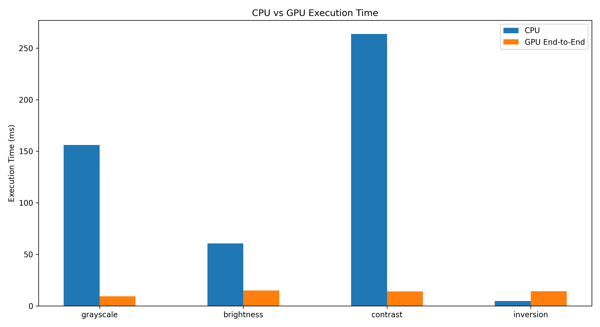
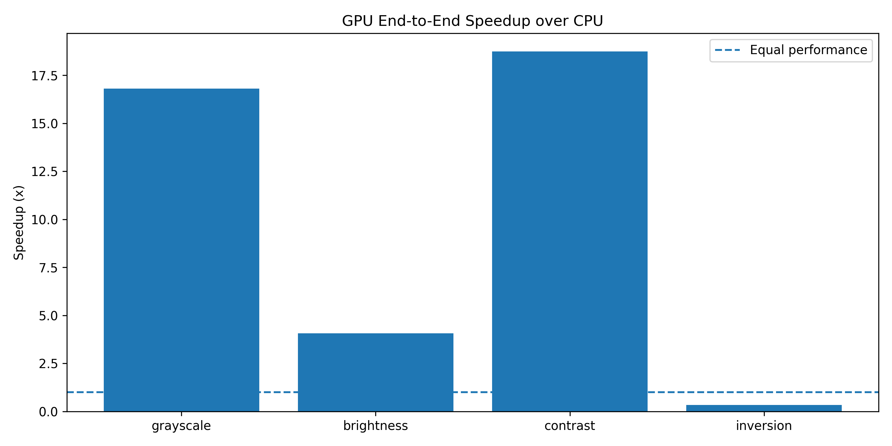

# CUDA-Accelerated Batch Image Processing

A batch image-processing project comparing CPU processing with custom CUDA GPU kernels using the CIFAR-10 image dataset.

## Project Overview

This project processes 10,000 CIFAR-10 test images (32 × 32 pixels) using four operations:

- RGB to Grayscale
- Brightness Adjustment (+40)
- Contrast Enhancement (factor 1.5)
- Image Inversion

The project compares CPU execution time with CUDA GPU kernel time and GPU end-to-end time, including data transfers.

## Technologies Used

- Python
- NumPy
- CUDA C++
- NVIDIA CUDA Toolkit
- Matplotlib

## Project Structure

\\\	ext
cifar10_cuda_project/
+-- data/                   # Dataset and binary input files (not committed)
+-- output/                 # Generated CPU and GPU outputs (not committed)
+-- results/
¦   +-- cpu_benchmark.csv
¦   +-- performance.csv
¦   +-- cpu_vs_gpu.png
¦   +-- gpu_speedup.png
+-- cpu_processing.py
+-- cpu_benchmark.py
+-- cuda_processing.cu
+-- cuda_benchmark.cu
+-- .gitignore
+-- README.md
\\\

## Benchmark Results

Measurements below are from the saved benchmark results for 10,000 images.

| Operation | CPU (ms) | GPU Kernel (ms) | GPU End-to-End (ms) | Kernel Speedup | End-to-End Speedup |
|---|---:|---:|---:|---:|---:|
| Grayscale | 156.149 | 0.324 | 9.286 | 482.42x | 16.82x |
| Brightness | 60.665 | 0.831 | 14.894 | 72.98x | 4.07x |
| Contrast | 263.755 | 0.873 | 14.067 | 302.09x | 18.75x |
| Inversion | 4.789 | 0.776 | 14.184 | 6.17x | 0.34x |

### Observations

- CUDA kernels execute substantially faster than the CPU implementations in these measurements.
- Grayscale and contrast show particularly high kernel speedups.
- End-to-end time includes host-to-device and device-to-host data transfers.
- Inversion is slower end-to-end on the GPU for this workload because transfer overhead outweighs the kernel-time advantage.

## Performance Graphs

### CPU vs GPU Performance

### GPU Speedup

## Requirements

- Python 3
- NumPy
- Matplotlib
- NVIDIA GPU compatible with your CUDA Toolkit
- NVIDIA CUDA Toolkit and NVCC compiler

Install Python packages:

\\\ash
pip install numpy matplotlib
\\\

## Running the CPU Programs

Make sure the dataset file \data/x_test.npy\ is available.

Run CPU image processing:

\\\ash
python cpu_processing.py
\\\

Run the CPU benchmark:

\\\ash
python cpu_benchmark.py
\\\

## Compiling the CUDA Programs

Compile using the NVIDIA CUDA compiler:

Linux:

\\\ash
nvcc cuda_processing.cu -o cuda_processing
nvcc cuda_benchmark.cu -o cuda_benchmark
\\\

Windows PowerShell:

\\\powershell
nvcc cuda_processing.cu -o cuda_processing.exe
nvcc cuda_benchmark.cu -o cuda_benchmark.exe
\\\

## Running the CUDA Programs

The CUDA programs expect a raw RGB binary input file and the number of images. Ensure \data/input.bin\ contains the RGB bytes for the images and the \output\ directory exists.

Linux:

\\\ash
./cuda_processing data/input.bin 10000
./cuda_benchmark data/input.bin 10000
\\\

Windows PowerShell:

\\\powershell
.\\cuda_processing.exe data\\input.bin 10000
.\\cuda_benchmark.exe data\\input.bin 10000
\\\

The benchmark prints CSV-formatted measurements to the terminal.

## Notes

- Dataset arrays, binary input files, generated output arrays, and compiled executables are excluded from Git using \.gitignore\.
- Benchmark timings depend on the CPU, GPU, CUDA version, and system load.
- The reported results are measurements from the saved experiment and may differ when rerun on another machine.

## Author

PON SARAVANA PANDIAN B

AI & Data Science  
Saveetha Engineering College
